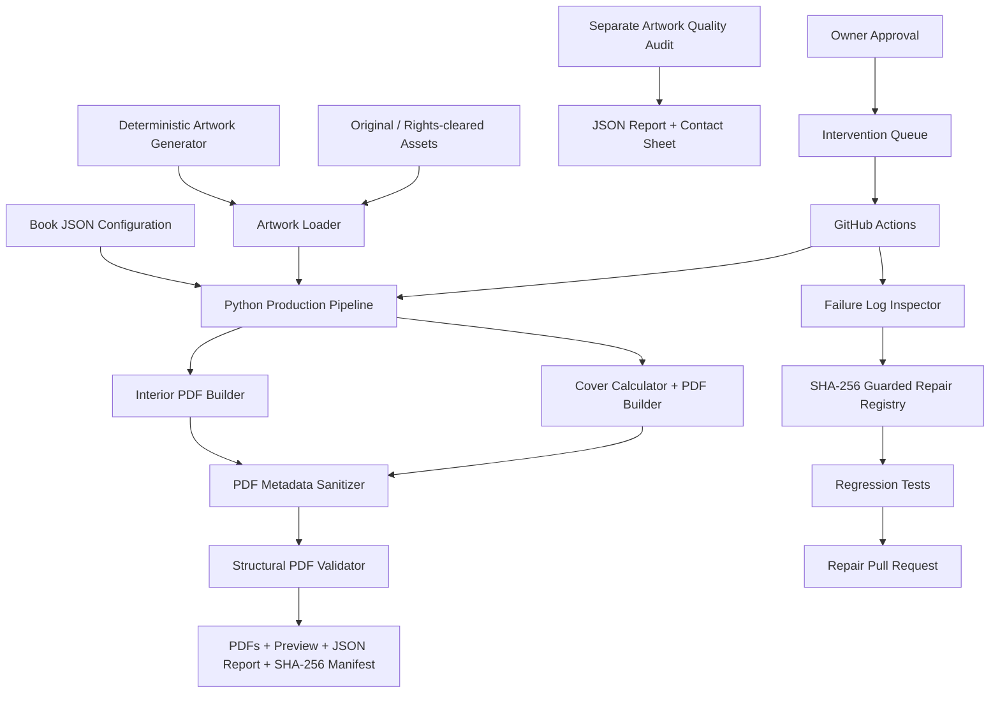

# Amazon KDP Production Engine

[](https://www.python.org/)
[](#8-testing--verification)
[](https://github.com/features/actions)
[](#proof-of-concept--enterprise-customization-readiness)

**A GitHub-native production and preflight toolkit for original children's coloring-book paperbacks.** It generates deterministic line-art samples, builds single-sided interiors and full-wrap covers, validates PDFs, and provides bounded workflow diagnostics and owner-controlled recovery.

The project is designed around free, open-source Python libraries and GitHub Actions. It does not auto-publish books to Amazon KDP and does not require paid APIs.

## 1. Project Overview & Problem Statement

Preparing a print-ready coloring book involves more than exporting images to PDF. Page parity, blank reverse pages, image resolution, margins, cover geometry, embedded fonts, metadata, originality, and KDP disclosure all need separate checks.

This repository provides a reproducible workflow for:

- Generating original, deterministic black-and-white coloring illustrations for fruits/vegetables, flowers, toys, birds, animals, and children's professions.
- Loading original, rights-cleared artwork and rejecting incomplete or pixel-identical asset sets.
- Building single-sided 8.5 × 11 in interiors with artwork on odd-numbered pages and fully blank even-numbered reverse pages.
- Calculating and generating full-wrap paperback covers, including paper-specific spine width and outer bleed.
- Sanitizing PDF metadata and validating page count, page geometry, effective DPI, blank pages, duplicate artwork, cover dimensions, CMYK drawing operators, and embedded fonts.
- Creating previews, JSON validation reports, and SHA-256 manifests.
- Inspecting failed GitHub Actions runs, applying only pre-registered deterministic repairs, and requiring explicit owner approval before resuming blocked work.

### Architecture



The artwork quality audit remains a separate workflow. The PDF pipeline requires an explicit `build_mode`: sample builds are named and recorded as unapproved samples; `production_candidate` builds fail closed unless `artwork_generation_spec.json` has `status: approved` and `pilot.commercial_50_artwork_release_authorized: true`. This gate permits only local candidate generation; it never authorizes KDP submission. Other policy items still require their documented reviews.

## 2. Tech Stack & Versions

| Component | Technology |
|---|---|
| Runtime | Python 3.12 in GitHub Actions; Python 3.11+ suitable for local use |
| Image generation / inspection | Pillow 12.3.0 |
| PDF generation | ReportLab 5.0.1 |
| PDF parsing / validation | pypdf 7.1.0 |
| Tests | Python standard-library `unittest` |
| Workflow linting | actionlint 1.7.12 |
| CI / artifacts / intervention | GitHub Actions, GitHub CLI, GitHub Issues and Pull Requests |
| Output integrity | SHA-256 |

Python dependencies are pinned in [`requirements.txt`](requirements.txt). The project does not require a JavaScript runtime, database, Docker service, model download, external AI API, or paid infrastructure for its core pipeline.

## 3. Prerequisites & Dependencies

- Git.
- Python 3.11 or later (CI currently uses Python 3.12).
- pip.
- Internet access for the initial installation of the three pinned Python packages.
- Optional: GitHub CLI (`gh`) for running the workflow-inspection and intervention scripts locally.
- Optional: original artwork files and documented commercial-use rights for externally sourced assets.

The GitHub Actions workflows use the repository-scoped `GITHUB_TOKEN`. No custom API key, paid API credential, or Telegram token is required.

## 4. Installation & Local Setup

Clone the repository and install the pinned dependencies:

```bash
git clone https://github.com/zopair/Amazon.git
cd Amazon

python -m venv .venv
# Linux / macOS
source .venv/bin/activate
# Windows PowerShell:
# .venv\\Scripts\\Activate.ps1

python -m pip install --upgrade pip
python -m pip install -r requirements.txt
```

### Build the 24-page review sample

```bash
python -m scripts.pipeline \
  --config config/book_meta.json \
  --output-dir build/output
```

The sample configuration targets 8.5 × 11 in, black ink on white paper, no interior bleed, 12 illustrations on odd pages, and 12 completely blank reverse pages.

### Build using the 100-page production configuration

```bash
python -m scripts.pipeline \
  --config config/book_meta.production.json \
  --output-dir build/production
```

This command currently fails closed: the artwork specification must have `status: approved` and `pilot.commercial_50_artwork_release_authorized: true`. Those markers must only be changed after the owner has completed the required visual, rights, and standards decisions. If the gate later passes, the outputs are labeled `PRODUCTION-CANDIDATE` and are not submitted to KDP. The production configuration currently contains the author value `Satisflo`; verify that publishing metadata before any future publishing decision.

### Run the complete test suite

```bash
python -m unittest discover -s tests -t . -v
```

### Run the separate artwork audit

Generate a 12-design pilot and inspect its technical report/contact sheet:

```bash
python - <<'PY'
from scripts.art_generator import generate_artwork

generate_artwork("fruit", 12, "build/artwork-pilot", dpi=300, line_width_pt=2.4)
PY

python -m scripts.artwork_quality \
  --input-dir build/artwork-pilot \
  --spec config/artwork_generation_spec.json \
  --report build/artwork-quality-report.json \
  --contact-sheet build/artwork-contact-sheet.png
```

The audit's PASS is limited to measurable file checks. It does not grant human visual approval, prove originality, establish rights, or detect near-duplicates.

## 5. Environment Variables

**The core production pipeline requires no environment variables.** Book settings are stored in JSON configuration files.

| Variable / setting | Used by | Purpose |
|---|---|---|
| `GITHUB_TOKEN` / `GH_TOKEN` | GitHub Actions and GitHub CLI scripts | Repository-scoped workflow, issue, artifact, and PR operations; supplied by GitHub Actions |
| `GITHUB_REPOSITORY` | Inspector workflow | Identifies the repository being inspected |
| `GITHUB_STEP_SUMMARY` | Inspector workflow | Writes human-readable diagnostic summaries |
| Workflow inputs | `kdp_pipeline.yml` | Selects the JSON book configuration path |
| Workflow inputs | `kdp-intervention-queue.yml` | Selects inspection or an explicitly approved resume operation |

No user-managed secrets are defined as required by the checked-in workflow configuration. The inspector workflow needs the repository's Actions permissions to allow GitHub Actions to create pull requests if an automated repair ever produces a tested change. If that repository setting is disabled, diagnostics can still run but PR creation may be blocked.

Do not put personal access tokens, KDP login credentials, or publishing account passwords into repository files or workflow inputs.

## 6. Usage Guide & Core Features

### Main configuration files

| File | Purpose |
|---|---|
| `config/book_meta.json` | 24-page Fruit Friends review sample (`build_mode: sample`) |
| `config/book_meta.production.json` | 100-page / 50-design production candidate (`build_mode: production_candidate`); author currently set to `Satisflo` |
| `config/series_defaults.json` | Shared trim, page-count, artwork, and series defaults |
| `config/themes.json` | Six supported theme categories and example subjects |
| `config/production_policy.json` | Machine-readable originality, print, metadata, and release policy |
| `config/artwork_generation_spec.json` | Pilot artwork constraints and human-review contract |
| `config/auto_fix_rules.json` | Deterministic repair registry; currently contains no repair rules |

### Build outputs

A successful pipeline run writes:

- `interior-SAMPLE.pdf` / `cover-SAMPLE.pdf` for sample builds.
- `interior-PRODUCTION-CANDIDATE.pdf` / `cover-PRODUCTION-CANDIDATE.pdf` only after the machine-readable artwork gate passes.
- Mode-specific preview, validation report, and manifest files.
- Every manifest records the build mode and release classification; `publication_authorized` is always `false`.

### Production rules and current implementation boundaries

- The built-in fruit/vegetable generator contains 50 named motifs. The other theme generators are separately defined in `scripts/theme_art.py`; verify the selected theme's actual motif count before selecting a 50-design configuration.
- The artwork loader generates a built-in set when the theme asset directory is empty. If any source assets are present, it requires an exact complete set for the selected book and rejects pixel-identical duplicates and colored source artwork.
- The sample and production JSON configurations currently set `line_width_pt` to 9.0, while `series_defaults.json` and the artwork quality workflow use 2.4 pt. This configuration drift must be reconciled before treating a series-wide line-width standard as locked.
- The generator rasterizes English subject-name labels into the artwork, while `artwork_generation_spec.json` currently declares `allow_text: false`. The quality auditor does not detect or enforce this text rule. Resolve this mismatch before relying on the artwork specification as a fully enforced contract.
- The main PDF pipeline now requires an explicit `build_mode`. A `production_candidate` build is rejected before output creation unless the artwork specification is marked `approved` and `commercial_50_artwork_release_authorized` is exactly `true`. This is a fail-closed build gate, not publication authorization; metadata, rights, KDP Print Previewer, and owner publication decisions remain separate.
- The 100-page configuration's `author` is `Satisflo`, while the 24-page sample leaves the author blank. Publishing metadata must be explicitly reviewed and aligned before submission.

### GitHub Actions workflows

| Workflow | Trigger / behavior |
|---|---|
| KDP Production Pipeline | Manual dispatch, relevant PRs, and pushes; runs unit tests, builds PDFs, validates output, and uploads a 14-day artifact |
| Artwork Quality Audit | Relevant artwork changes or manual dispatch; generates a 12-design pilot and uploads a report/contact sheet |
| KDP Self-Healing Inspector | Inspects failed production/test workflow runs, classifies logs, and can request a bounded retry for classified transient failures |
| Inspector Tests | Runs unit tests and actionlint against workflow changes |
| KDP Intervention Queue | Scheduled every six hours or manually; resumes only runs explicitly marked with the required owner-approval labels |

The repair registry is currently empty, so no deterministic source-code repair is configured for automatic application. Unknown failures are for human review. The intervention queue does not authorize a resume unless the issue carries both `human-intervention` and `approved-to-resume` labels, or a manual resume includes a sufficiently explicit approval note.

See [KDP Technical Specification](docs/KDP_TECHNICAL_SPECIFICATION.md), [Book Production Constitution](docs/BOOK_PRODUCTION_CONSTITUTION.md), [Artwork Quality Gate](docs/ARTWORK_QUALITY_GATE.md), [Self-Healing Inspector](docs/SELF_HEALING_INSPECTOR.md), and [Dependency Audit](docs/DEPENDENCY_AUDIT.md).

## 7. Live Demo & Screenshots

No public hosted application or interactive web demo is part of this repository. The reproducible demonstration is the local pipeline and its generated PDF/PNG/JSON artifacts.

GitHub Actions artifacts are attached to their individual workflow runs and are retained for 14 days. The repository's artwork audit produces a contact sheet for review; no generated preview is presented here as an approved or published KDP book.

## 8. Testing & Verification

Run all tests locally:

```bash
python -m unittest discover -s tests -t . -v
```

The test suite covers:

- Cover spine and full-wrap geometry.
- Configuration constraints, trim, margins, page count, DPI and minimum line-width policy.
- Rejection of invalid or out-of-scope configuration paths.
- Generation of artwork for the supported themes.
- 24-page sample creation, odd-page artwork and blank reverse pages.
- PDF metadata removal, embedded cover fonts, CMYK cover drawing, and duplicate illustration detection.
- Artwork quality checks for dimensions, DPI, binary palette, transparency, safe inset, and pixel-identical duplicates.
- Failure classification, guarded repair rules, and intervention approval logic.

### CI evidence observed during this review

- **Inspector Tests:** latest observed PR run on 22 November 2026 — Success; 47/47 Python tests passed.
- **KDP Intervention Queue:** latest observed scheduled run on 27 November 2026 — Success; no approved intervention was resumed.
- **KDP Production Pipeline:** latest observed main build remains the 21 November 2026 24-page / 12-illustration sample; no 100-page production-candidate build was run.
- **Artwork Quality Audit:** latest observed Christmas audit on 22 November 2026 inspected 50 motifs, reported 0 automated errors and 3 occupancy warnings, with human review pending.

A successful Inspector Tests workflow is not proof that a new PDF build or KDP upload was accepted. Always inspect the generated PDFs and use KDP Print Previewer before any publication decision.

## Proof of Concept & Enterprise Customization Readiness

**Status: PoC / MVP — local production tooling and GitHub automation, not a publishing platform.**

| Capability | Verified state |
|---|---|
| Deterministic artwork | Implemented for six themes; motif counts differ by theme |
| Interior PDF generation | Implemented for the configured 8.5 × 11 in profile |
| Cover geometry and PDF generation | Implemented with paper coefficients, CMYK drawing, and embedded fonts |
| PDF structural validation | Implemented; automated preflight only |
| Artwork technical audit | Implemented as a separate workflow; human review remains pending |
| Build artifacts and SHA-256 manifest | Implemented in the pipeline |
| Failure diagnostics | Implemented for recognized GitHub Actions log patterns |
| Automatic repairs | Framework implemented; repair registry currently empty |
| Owner-controlled resume | Implemented through issue labels and manual approval-note validation |
| KDP publishing | Not integrated; no automatic account access or publication |
| Release governance | Explicit fail-closed production-candidate build gate; remaining print-preview, rights, metadata, and publication gates still require human review |
| License | No root `LICENSE` file was present in the reviewed repository tree; redistribution terms should be clarified |

### Readiness gaps before commercial use

1. Reconcile the 2.4 pt versus 9.0 pt line-width configuration.
2. Reconcile the artwork specification's no-text rule with the generator's rasterized subject labels.
3. Wire remaining print-preview, rights, metadata, and publication approval evidence into a separate release record before commercial use.
4. Confirm the intended publishing author/imprint and align every book configuration and cover.
5. Complete visual originality, similarity, rights-provenance, and full-volume review for every design.
6. Validate every final PDF in the official KDP Print Previewer and confirm current KDP requirements before upload.
7. Add an explicit project license only after confirming the intended licensing terms and third-party obligations.

Enterprise customization could add multi-book orchestration, approval records, rights provenance, catalog-level duplicate analysis, richer QA reporting, and additional print profiles without introducing paid services into the core pipeline.

## Intellectual Property & Authorship

Project authorship and attribution: **Aly Hussein Zopair (علي حسين زبير ALY HUSSEIN ZOPAIR)**.

This authorship notice does not create a software license or grant rights to third-party libraries, fonts, or artwork. Every included or externally sourced asset must retain its applicable license and rights evidence.
